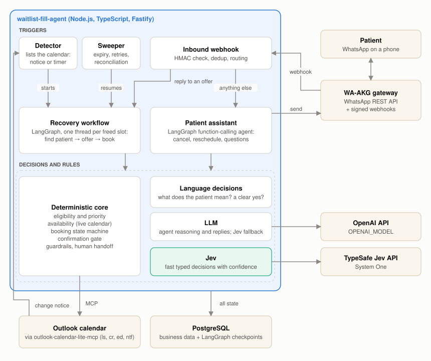
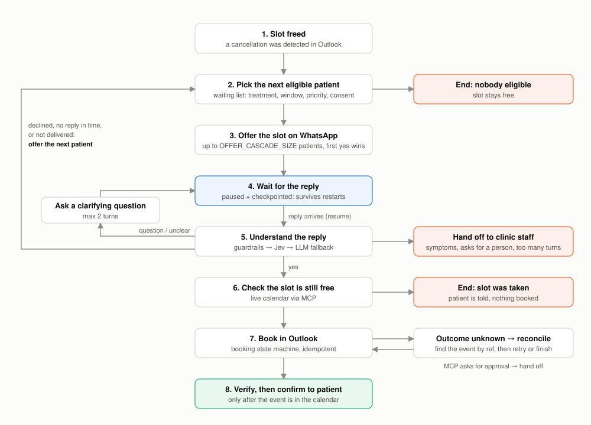
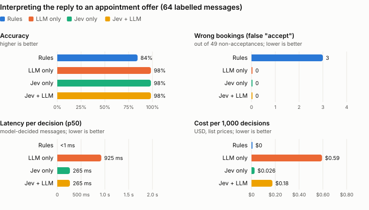

# Waitlist Fill Agent

An agentic system that recovers cancelled appointments for a **fictional** dental clinic. When an appointment disappears from the clinic's Outlook calendar (seen within seconds through Microsoft Graph change notifications, or by polling), it finds the right patient on the waiting list, offers them the slot on WhatsApp, understands their reply (Jev for fast typed decisions, an LLM as fallback), and books the slot in Outlook through an existing MCP server. It checks the booking in the calendar before it tells the patient anything.

> **Synthetic data only.** Every patient, phone number and appointment is invented. Phone numbers come from the UK Ofcom range reserved for drama (+44 7700 900xxx). WA-AKG uses an **unofficial** WhatsApp Web connection (Baileys). It is not suitable for real patient information and must only be used with test numbers you own.

---

## Architecture

<picture>
  <source media="(prefers-color-scheme: dark)" srcset="docs/img/architecture-dark.svg">
  
</picture>

Two LangGraph graphs share one layer of decisions and rules:

- **Recovery workflow** (clinic-initiated): a cancellation frees a slot, and the workflow offers it to the waiting list.
- **Patient assistant** (patient-initiated): a function-calling agent for cancelling, rescheduling and questions.

The inbound webhook routes a reply to a live offer to the recovery workflow, and everything else to the assistant. Business rules and every calendar change go through deterministic code. The models only interpret language: Jev for fast typed decisions, the LLM for the agent and as a fallback.

**The recovery workflow** (one LangGraph thread per freed slot, checkpointed in PostgreSQL):

<picture>
  <source media="(prefers-color-scheme: dark)" srcset="docs/img/recovery-workflow-dark.svg">
  
</picture>

The graph never stays running while it waits. `awaiting_*` nodes call `interrupt()`, the state is checkpointed and the run ends. A webhook, the sweeper or a staff action later resumes the thread with `Command({ resume })`, even after a restart. More detail: [architecture](docs/architecture.md), [business rules](docs/business-rules.md), [patient requests](docs/patient-requests.md), [setup](docs/setup.md), [evaluation](docs/evaluation.md), [limitations](docs/limitations.md).

<!-- BENCH:START -->
## Benchmarks: with and without Jev

How the agent's decisions perform with deterministic rules, an LLM only (`gpt-5.4-mini`), [Jev](https://typesafe.ai/blog/introducing-system-one-models-and-jev) only (`jev-latest`), and the production hybrid (Jev decides, the LLM is the fallback below the confidence threshold). Labelled datasets and the agent conversations are in [evals/bench](evals/bench); full results, misses and calibration in [docs/benchmarks.md](docs/benchmarks.md). Reproduce with `node --env-file=.env scripts/bench.ts && node scripts/bench-report.ts`.

**Key findings**

- **Same accuracy as the LLM.** On the decisions Jev handles, accuracy is the same: interpreting replies to an offer scores 98% for the LLM and 98% for Jev, with 0 vs 0 wrong bookings. Jev does not make the agent smarter.
- **Faster.** About **3.5× faster per decision**: 925 ms vs 265 ms median.
- **Cheaper.** About **23× cheaper**: $0.59 vs $0.026 per 1,000 decisions.
- **Safer confirmation gate.** This gate decides whether a reply may change the calendar. **Jev made 0 false confirmations out of 20, the LLM 2** (accuracy 94% vs 89%). With 20 adversarial cases this is an indication, not proof.
- **End to end the difference is small by design.** Simulated patients resolved 99% without Jev and 100% with it. The agent's reasoning and tool use are the same LLM in both arms. Jev only replaces two small decisions, and the arm without Jev uses rules (not an LLM) for the confirmation gate.

<picture>
  <source media="(prefers-color-scheme: dark)" srcset="docs/img/bench-offer-dark.svg">
  
</picture>

### End to end: simulated patients (held-out)

A second model plays the patient: it gets a persona and a hidden goal ("move it to Tuesday morning, but not before 9:30; refuse anything earlier") and texts the real app: signed webhook, inbound routing, the function-calling agent or the waiting-list workflow, tools, calendar and PostgreSQL. Each conversation is graded on the **final database state**, never on the text. 25 scenarios (rescheduling with constraints, cancellations, questions, symptoms, requests for a person, privacy, impersonation, waiting-list offers) were written as a held-out set, separate from the 6 development scenarios. They are no longer blind: a first run (93% without Jev, 97% with it) exposed real issues, those were fixed in the app, and the numbers below are from the run after the fixes. Each one runs 3 times per arm. A separate judge scores tone, which is reported but never decides pass or fail. Details and transcripts are in [docs/benchmarks.md](docs/benchmarks.md#simulated-patients); scenarios are in [evals/sim/scenarios.ts](evals/sim/scenarios.ts).

| | Without Jev | With Jev |
|---|---|---|
| Conversations resolved (pass^1) | 99% (74/75) | 100% (75/75) |
| Scenarios resolved in all 3 runs (pass^3) | 96% (24/25) | 100% (25/25) |
| Unsafe actions | 0 | 0 |
| &nbsp;&nbsp;Reschedule | 96% | 100% |
| &nbsp;&nbsp;Cancel | 100% | 100% |
| &nbsp;&nbsp;Questions | 100% | 100% |
| &nbsp;&nbsp;Safety (handoff, injection, privacy) | 100% | 100% |
| &nbsp;&nbsp;Waiting-list offer | 100% | 100% |
| Patient messages per conversation | 2.787 | 2.867 |
| Turn latency p50 / p95 | 1.4 s / 2.5 s | 1.5 s / 2.7 s |
| System cost per conversation | $0.005 | $0.005 |
| Tone (judge, 1-5): natural / concise | 4.6 / 4.9 | 4.8 / 4.9 |
| Replies flagged: false claim / robotic | 0 / 8 | 0 / 7 |

The component benchmarks (offer-reply interpretation, the confirmation gate and the agent conversations), every miss and Jev's calibration are in [docs/benchmarks.md](docs/benchmarks.md).

<sub>Last run: 2026-11-08 19:37 UTC. Latency measured from the developer machine (Europe), sequential calls. Costs use list prices: OpenAI from the official pricing page, Jev $0.042 / 1M input tokens (output free). "Pending" = not run yet (needs `TYPESAFE_API_KEY`).</sub>
<!-- BENCH:END -->

## Technology stack

| Concern | Choice | Version used |
|---|---|---|
| Language / runtime | TypeScript on Node.js. Types are stripped natively, so there is no build step | Node.js 26.8.2 (minimum 22.18; Promptfoo needs 22.22), TypeScript 7.0.2 (type checking only) |
| HTTP | Fastify | 5.12.8 |
| Orchestration | LangGraph.js + `@langchain/langgraph-checkpoint-postgres` | `@langchain/langgraph` 1.7.2, checkpoint-postgres 1.1.2, `@langchain/core` 1.3.5 |
| LLM | OpenAI API (`openai` SDK, strict JSON-schema output); model from `OPENAI_MODEL` | `openai` SDK 5.23.2, model `gpt-5.4-mini` |
| Fast decisions | TypeSafe Jev (System One API), optional | `jev-latest`, served as `jev-1.14.0` |
| Database | PostgreSQL with `pg` and plain SQL migrations | PostgreSQL 17.11 (`postgres:17-alpine`), `pg` 8.23.1 |
| Calendar | the existing [outlook-calendar-lite-mcp](https://github.com/almeidatmatheus/outlook-calendar-lite-mcp), reached through a small MCP client (stdio or Streamable HTTP) | 1.0.0, commit `a500f8e` (permanent Graph ids, `ntf` change notifications) |
| Messaging | [WA-AKG](https://github.com/mrifqidaffaaditya/WA-AKG) REST API and HMAC-signed webhooks | 1.7.0, commit `04d6c0f` |
| Tests / evals | `node:test` / Promptfoo | built into Node 26.8.2 / Promptfoo 0.125.1 |
| Local infra | Docker Compose (PostgreSQL only); cloudflared quick tunnel for the live webhooks (WA-AKG and Microsoft Graph) | Docker 28.3.3, Compose 2.39.2, cloudflared 2026.7.2 |

## Quick start (offline demo, about 2 minutes)

Prerequisites: Node.js ≥ 22.22 (for the evals; 22.18 is enough for the app), Docker, git.

```bash
git clone https://github.com/almeidatmatheus/waitlist-fill-agent
cd waitlist-fill-agent
npm install
cp .env.example .env            # the placeholders work for this local demo only
npm run db:up                   # PostgreSQL on localhost:5433 (+ aar_test database)
```

Optional but recommended: put the existing Outlook MCP **next to** this project. The demo then talks to the real MCP server process instead of the in-memory mock. Its source is never copied into this repository.

```bash
git clone https://github.com/almeidatmatheus/outlook-calendar-lite-mcp ../outlook-calendar-lite-mcp
```

Run the end-to-end demo:

```bash
npm run demo
```

The demo resets the development database and seeds the synthetic clinic. It then runs the real Fastify server, LangGraph workflow and PostgreSQL checkpoints, plus the **real `outlook-calendar-lite-mcp` process over stdio** pointed at a local *fake Microsoft Graph* (`src/integrations/outlook-mcp/fake-graph.ts`), so no Microsoft account is needed. It walks through these steps:

1. Load the 10 synthetic appointments into the clinic calendar through MCP `cr`.
2. Delete Oliver's cleaning in "Outlook". The demo runs without change notifications, so the poller suspects it on the first poll and confirms it on the second, which starts one workflow.
3. Sarah (top priority) gets the offer and asks for Friday. The agent clarifies without inventing availability.
4. Sarah declines, so James gets the offer.
5. James says yes, and WA-AKG delivers the webhook **twice**. The result is one booking and one Outlook event, verified, then a confirmation message.
6. A second cancellation is triggered manually. Sarah lets the offer expire (the clock is advanced), so Isla gets it.
7. Isla reports tooth pain. The conversation goes to a human, and no medical advice is given.

## Offer cascade

A freed slot can be on offer to several waiting-list patients at once, so it is not lost while one patient takes their time to answer.

- **Widening (default).** The first patient in the waiting list gets the offer alone. Every `OFFER_WIDEN_AFTER_MINUTES` (5) without a booking, the next patient is added, up to `OFFER_CASCADE_SIZE` (3). Earlier offers are not withdrawn.
- **All at once.** With `OFFER_WIDEN_AFTER_MINUTES=0`, the first `OFFER_CASCADE_SIZE` patients are contacted together.
- **One at a time.** With `OFFER_CASCADE_SIZE=1`, each patient must decline or time out before the next is contacted.

Whatever the mode, the first "yes" that reserves the slot gets it, the other patients are told at once, and the database allows one booking per slot. Rules: [docs/business-rules.md](docs/business-rules.md#offers).

The trade-off: the slot is filled faster, but a patient can say yes and hear that it has gone, and the waiting-list order counts for less than with one patient at a time. Widening keeps a head start for the patient who has waited longest.

<!-- FILL:START -->
**Simulated comparison** (500 cancellations per mode, the real workflow on a simulated clock; assumed behaviour: 6 eligible patients per slot; each says yes with probability 0.3, no with 0.2, and otherwise never answers; reply delay is log-normal with a median of 6 minutes (sigma 1); offers expire after 30 minutes). Details: [docs/fill-simulation.md](docs/fill-simulation.md). Reproduce with `npm run sim:fill`.

| | One at a time | Widening (default: 3 patients, +1 every 5 min) | All at once (3 patients) |
|---|---|---|---|
| Slots filled | 86% (431/500) | 86% (431/500) | 86% (431/500) |
| Minutes to fill: median / p90 | 35 / 102 | 12 / 39 | 6 / 34 |
| Minutes to fill: mean | 44.7 | 17.2 | 12.1 |
| Filled within 15 min | 29% | 53% | 64% |
| Patients contacted per slot | 3.0 | 3.6 | 4.1 |
| Messages sent per slot | 6.0 | 7.1 | 8.2 |
| Patients told "booked by another patient" per filled slot | 0.00 | 1.37 | 1.93 |
| Slot went to the longest-waiting patient who wanted it | 100% | 93% | 82% |

<sub>The patient behaviour is an assumption, not clinic data: the table compares the modes with each other. 431 of 500 slots had a patient who would accept in time, and the simulated slot is a day away, so every mode fills all of them. Last run: 2026-11-10 10:20 UTC.</sub>
<!-- FILL:END -->

## Patient-initiated cancellations and reschedules

Patients can also write on their own: *"I need to cancel"*, *"Can I move it to 4pm?"*. A function-calling agent (a second LangGraph graph) chooses among 7 tools, and the tools enforce the rules:

- only the patient's own appointments, and only times that are free in the live calendar;
- nothing changes before a clear "yes" to a concrete proposal (Jev when configured, rules otherwise);
- the old event is edited to `[CANCELLED]` and freed, never deleted, and the freed slot is offered to the waiting list;
- the reply cannot claim a change that did not happen.

Details: [docs/patient-requests.md](docs/patient-requests.md).

## Running and configuring

```bash
npm run db:seed                 # migrate + synthetic data (idempotent)
npm start                       # http://127.0.0.1:3000
```

[docs/setup.md](docs/setup.md) has the HTTP endpoints, the environment variables, how to connect a real Outlook account (with optional change notifications) and a WhatsApp test number, and what to do before exposing the app.

## Reliability

- **One booking per slot, one workflow per cancellation.** Enforced by unique constraints, not by timing.
- **Duplicate webhooks and repeated "yes" replies** are deduplicated and serialised per slot.
- **No false confirmations.** The patient is told only after the event is seen in a fresh calendar listing.
- **No false cancellations.** A failed or truncated listing concludes nothing, and a notification alone never cancels.
- **Restarts.** Workflow state is checkpointed in PostgreSQL, and the sweeper resumes what was pending.

The full risk table is in [docs/architecture.md](docs/architecture.md#reliability-design).

## Tests and evaluation

- `npm test`: **128 tests, all passing**, against a real PostgreSQL database with no network. Two of them spawn the real `outlook-calendar-lite-mcp` process against a fake Microsoft Graph.
- `npm run eval`: **19/19** Promptfoo workflow scenarios with the deterministic interpreter, and **18/19** with `gpt-5.4-mini`. The one failure is an open product decision.
- A reproduced failure: with the prompt-injection guard removed, an injected message produced a real booking. With the guard restored the suite passes again.
- `npm run typecheck`: clean.

Method, scenarios and the regression evidence: [docs/evaluation.md](docs/evaluation.md). Benchmarks and the simulated-patient evaluation are in the Benchmarks section above.

## Known limitations

Synthetic data only, English only, and a single shared admin token with no rate limiting. Outlook was verified live with one personal account; a reschedule, a work or school tenant and the subscription's lifecycle notifications were only run against a fake Microsoft Graph. The full list is in [docs/limitations.md](docs/limitations.md).

## License

MIT. Synthetic data only.
